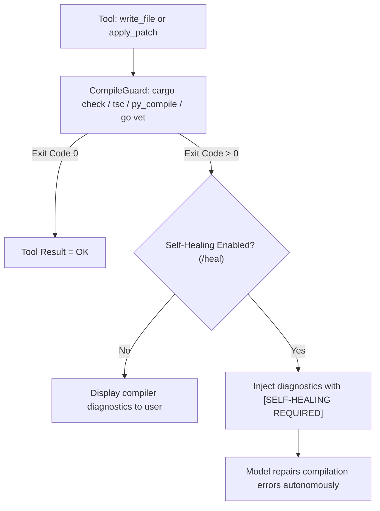

# Orbit CLI (`orbit-cli`) — User Manual & Technical Reference
*Version: 0.2.0 — October 2026*  
*(Nederlandse handleiding beschikbaar in [docs/MANUAL_NL.md](docs/MANUAL_NL.md))*

**Orbit CLI** (`orbit-cli`) is an autonomous, high-performance AI coding agent written in pure Rust. Built on top of OpenRouter's multi-model API, Orbit delivers real-time SSE token streaming, full Model Context Protocol (MCP `2024-11-05`) tool execution across both REPL and fullscreen TUI modes, multi-agent DAG orchestration, git intelligence, and compiler-driven self-healing.

---

## Table of Contents
1. [Architecture & Core Principles](#1-architecture--core-principles)
2. [Installation & System Configuration](#2-installation--system-configuration)
3. [Launch Modes & CLI Flags](#3-launch-modes--cli-flags)
4. [Multi-Model Routing, Caching & Resilience](#4-multi-model-routing-caching--resilience)
5. [Code Editing & Quality Gates](#5-code-editing--quality-gates)
6. [Subagents, DAG Orchestration & Adversarial Review](#6-subagents-dag-orchestration--adversarial-review)
7. [Workspace Intelligence & Built-in Tools](#7-workspace-intelligence--built-in-tools)
8. [Real-Time Streaming Syntax Highlighting](#8-real-time-streaming-syntax-highlighting)
9. [Complete Slash Commands Reference](#9-complete-slash-commands-reference)
10. [Vim Modal Editing & Keybindings (TUI & REPL)](#10-vim-modal-editing--keybindings-tui--repl)
11. [Practical Workflows & Recipes](#11-practical-workflows--recipes)

---

## 1. Architecture & Core Principles

Orbit is engineered around four architectural pillars:

1. **Sub-10ms Startup & Zero Runtime Bloat**:
   - Compiled into a single native Rust binary (`orbit-cli` with `orbit` shorthand symlink).
   - Starts in under 10 milliseconds with zero `node_modules`, Python virtualenvs, or heavy Electron webviews.
2. **Deterministic Code Quality & AST Compile Guards**:
   - After every file modification (`write_file` or `apply_patch`), Orbit automatically runs the project's native compiler or type-checker (`cargo check`, `tsc --noEmit`, `py_compile`, `go vet`).
   - When compiler errors occur, an autonomous self-healing loop feeds diagnostics back to the model to repair the code before returning control to the user.
3. **Cost Efficiency via Tiered Routing & Prompt Caching**:
   - Automatic injection of ephemeral `cache_control` blocks for system prompts, project rules, and large reference files, cutting input token costs by up to 90% on supported providers (Claude, DeepSeek).
   - Hybrid model cascading routes exploratory/search queries to fast, low-cost models (`google/gemini-2.5-flash`) and escalates complex implementation/refactoring tasks to frontier reasoners (`anthropic/claude-sonnet-4.5`, `deepseek/deepseek-r1`).
4. **Surgical In-Place Patching**:
   - Native support for Aider-style `<<<<<<< SEARCH ... ======= ... >>>>>>> REPLACE` blocks (`apply_patch`). Instead of regenerating entire 1,000-line files, Orbit patches only the modified lines in place—saving 80–95% output tokens and preventing accidental code deletion.

---

## 2. Installation & System Configuration

### 2.1 Installation Methods

#### Option 1: One-Line Installer (Linux & macOS)
```bash
curl -fsSL https://raw.githubusercontent.com/dwaddle/orbit-cli/main/install.sh | sh
```
Installs `orbit-cli` and the `orbit` symlink into `~/.local/bin`.

#### Option 2: Cargo (Rust)
```bash
cargo install --git https://github.com/dwaddle/orbit-cli
```

#### Option 3: Arch Linux (`PKGBUILD`)
```bash
git clone https://github.com/dwaddle/orbit-cli.git
cd orbit-cli/packaging/aur && makepkg -si
```

#### Option 4: Build from Source
```bash
git clone https://github.com/dwaddle/orbit-cli.git
cd orbit-cli
cargo build --release
```

### 2.2 Central Configuration (`~/.config/openrouter/config.json`)
On first launch, Orbit creates `~/.config/openrouter/` and prompts for your OpenRouter API key if `OPENROUTER_API_KEY` is not set in the environment.

Example `config.json`:
```json
{
  "api_key": "sk-or-v1-...",
  "active_model": "anthropic/claude-sonnet-4.5",
  "tools_enabled": true,
  "prompt_caching": true,
  "cascading_enabled": false,
  "fast_model": "google/gemini-2.5-flash",
  "heavy_model": "anthropic/claude-sonnet-4.5",
  "fallback_models": [
    "anthropic/claude-sonnet-4.5",
    "openai/gpt-4o",
    "deepseek/deepseek-r1",
    "google/gemini-2.5-flash"
  ],
  "adversarial_review_enabled": false,
  "compile_guard_enabled": true,
  "self_healing_enabled": true,
  "syntax_highlighting": true,
  "vim_mode": true
}
```

#### Configuration Fields:
| Key | Type | Default | Description |
|---|---|---|---|
| `api_key` | String | `""` | OpenRouter API bearer token (`sk-or-v1-...`). |
| `active_model` | String | `anthropic/claude-sonnet-4.5` | Default model for REPL and TUI sessions. |
| `tools_enabled` | Boolean | `true` | Enables autonomous tool execution in REPL and TUI. |
| `prompt_caching` | Boolean | `true` | Injects OpenRouter `cache_control` headers for static context. |
| `cascading_enabled` | Boolean | `false` | Enables two-tier automatic model escalation based on prompt complexity. |
| `fast_model` | String | `google/gemini-2.5-flash` | Model used for repository exploration, search, and summarization. |
| `heavy_model` | String | `anthropic/claude-sonnet-4.5` | Model used for complex refactoring, architecture, and code generation. |
| `fallback_models` | Array | `[...]` | Ordered failover chain on HTTP 429 (rate limit) or 5xx provider errors. |
| `compile_guard_enabled` | Boolean | `true` | Runs compiler/type checks immediately after `write_file` and `apply_patch`. |
| `self_healing_enabled` | Boolean | `true` | Automatically feeds compiler diagnostics back to the model for self-repair. |
| `adversarial_review_enabled` | Boolean | `false` | Automatically runs an independent reviewer subagent after file edits. |
| `syntax_highlighting` | Boolean | `true` | Enables real-time syntax coloring for streamed markdown code blocks. |
| `vim_mode` | Boolean | `true` | Enables Vim modal editing (`NORMAL`, `INSERT`, `VISUAL`) in REPL and TUI. |

### 2.3 Model Context Protocol (MCP `2024-11-05`) Configuration
Orbit includes a native MCP client (`src/mcp.rs`) implementing JSON-RPC 2.0 over `stdio`, including the MCP `2024-11-05` `initialize` request and `notifications/initialized` handshake (supporting Rust, Node.js, and Python `FastMCP` servers).

Configure external MCP servers in `~/.config/openrouter/mcp.json` or `~/.config/orbit/mcp.json`:
```json
{
  "mcpServers": {
    "filesystem": {
      "command": "npx",
      "args": ["-y", "@modelcontextprotocol/server-filesystem", "/path/to/workspace"]
    },
    "custom-python-mcp": {
      "command": "/usr/local/bin/my-fastmcp-server",
      "args": []
    }
  }
}
```
At startup, Orbit spawns each configured server, queries `tools/list`, and injects the discovered tool names, descriptions, and JSON parameter schemas directly into the agent's system prompt. Both the REPL and fullscreen TUI (`orbit -t`) execute MCP tools autonomously and support `/mcp` to inspect connected servers and tools.

### 2.4 Automatic Project Rules Discovery (`.orbitrules` / `AGENTS.md`)
Orbit searches upward from the current working directory for project-specific rule files in the following order:
1. `.orbitrules`
2. `AGENTS.md`
3. `.agents/AGENTS.md`
4. `.orbit/rules.md`

Discovered rules are automatically injected at the top of the system prompt.

---

## 3. Launch Modes & CLI Flags

### A. Interactive REPL (Default)
```bash
orbit-cli
# or:
orbit
```
Launches the interactive terminal REPL featuring persistent command history, live Vim modal editing (`orbit [INSERT] >`), multi-line continuation (`\`), and slash commands.

### B. Fullscreen Split-Pane TUI (Ratatui)
```bash
orbit-cli --tui
# or:
orbit -t
```
Launches a fullscreen split-pane terminal UI built with `ratatui` and `crossterm`, featuring a high-contrast color palette (`White`, `Cyan`, `LightGreen`, `Yellow`) designed for crisp readability on transparent terminals:
- **Left Sidebar**: Interactive workspace file browser (`Cyan` directories, bright `White` files).
- **Top-Right Pane**: Real-time monitor for active background subagents.
- **Center-Right Pane**: Streaming conversation window with syntax highlighting and autonomous multi-step tool/MCP execution.
- **Bottom Pane**: Modal prompt input bar with live mode badges (`[NORMAL]`, `[INSERT]`, `[VISUAL]`).

### C. Background File Watcher & Test Runner
```bash
orbit-cli watch
# or inside REPL:
/watch start
```
Monitors workspace source files (`.rs`, `.py`, `.ts`, `.js`, `.go`) via `notify` with a 400ms debounce timer and automatically runs the detected test suite (`cargo test`, `pytest`, `bun test`, `npm test`, `go test`) on save.

---

## 4. Multi-Model Routing, Caching & Resilience

- **Prompt Caching (`/cache`)**: Marks static system instructions, project rules, and large reference files with `"cache_control": { "type": "ephemeral" }`, reducing repeated prompt token costs by up to 90%.
- **Hybrid Model Cascading (`/cascade`)**: Classifies prompts at runtime—routing read/search/inspection queries to `fast_model` and implementation/refactoring queries to `heavy_model`.
- **Auto-Failover (`/fallback`)**: Automatically retries failed requests across `fallback_models` when an upstream provider returns HTTP 429 or 5xx errors, preserving full conversation context.

---

## 5. Code Editing & Quality Gates

### 5.1 Surgical Search-and-Replace Patching (`apply_patch`)
```text
<<<<<<< SEARCH
    let timeout = 30;
    connect_to_server(timeout)?;
=======
    let timeout = 60;
    connect_to_server(timeout * 2)?;
>>>>>>> REPLACE
```
- **Disambiguation Guard**: Rejects ambiguous search blocks that match multiple locations, prompting the model to provide sufficient surrounding context.
- **Whitespace Tolerance**: Falls back to line-trimmed matching when indentation differs slightly.

### 5.2 AST Compile Guard & Self-Healing Loop (`/guard`, `/heal`, `/compile`)


### 5.3 Instant Checkpoints & Rollback (`/undo`, `/checkpoints`)
Before every mutating tool call (`write_file` or `apply_patch`), `CheckpointManager` records an in-memory snapshot of the target file. Run `/undo` to immediately restore the previous file state (or remove newly created files).

### 5.4 Deterministic TDD Loop (`/tdd <spec>`)
```text
/tdd Implement a thread-safe TokenBucket rate limiter in Rust with burst capacity
```
1. **Red Phase**: Writes unit tests for the specification and verifies that the test runner fails as expected.
2. **Green Phase**: Writes the minimal implementation and iterates (up to 3 self-healing passes) until 100% of tests pass.
3. **Refactor Phase**: Cleans up implementation while maintaining a green test suite.

---

## 6. Subagents, DAG Orchestration & Adversarial Review

### 6.1 Subagent DAG Workflows (`/dag`)
Execute multi-agent dependency graphs concurrently via Tokio channels (`src/subagent.rs`), where upstream task outputs feed automatically into downstream tasks:
- `/dag audit`: Parallel Security Audit + Performance Audit -> Unified Synthesis Report.
- `/dag feature`: Parallel Architecture Plan + Test Suite Design -> Implementation Synthesis.

### 6.2 5-Axis Adversarial Review (`/review`, `/adversarial`)
Spawns an independent reviewer subagent (`src/review.rs`) that critiques diffs across 5 strict dimensions:
1. **Correctness** (logic bugs, edge cases, off-by-one errors)
2. **Security** (OWASP vulnerabilities, injection risks, unsafe blocks)
3. **Error Handling** (missing context, panics, unchecked `unwrap()`)
4. **Test Coverage** (missing regression or boundary tests)
5. **Performance** (unnecessary allocations, $O(N^2)$ loops)

---

## 7. Workspace Intelligence & Built-in Tools

| Tool Name | Purpose |
|---|---|
| `run_command` | Execute shell commands and capture `stdout`/`stderr`. |
| `view_file` | Read files with optional line-range slicing. |
| `write_file` | Create or overwrite files (guarded by automatic checkpoints & compile checks). |
| `apply_patch` | Apply surgical `SEARCH/REPLACE` blocks in place. |
| `tdd_cycle` | Run autonomous Red -> Green -> Refactor TDD workflows. |
| `code_search` | Query the in-memory BM25 inverted code index (`/search`). |
| `code_outline` | Extract symbol maps (`fn`, `struct`, `class`, `interface`, `trait`) (`/outline`). |
| `git_context` | Inspect commit logs, line-range blame, diffs, and pickaxe search (`/git`). |
| `invoke_subagent` | Spawn asynchronous background subagents. |
| `adversarial_review` | Run 5-axis security and quality review on files or git diffs. |
| `run_dag` | Execute concurrent multi-agent DAG workflows. |

---

## 8. Real-Time Streaming Syntax Highlighting (`/highlight`, `/syntax`)

`StreamingHighlighter` (`src/highlight.rs`) buffers incoming SSE chunks line-by-line and applies syntax coloring for `Rust`, `Python`, `TypeScript/JavaScript`, `Go`, `Bash`, `SQL`, `JSON`, `TOML`, `YAML`, and `C/C++` inside framed terminal blocks:
```text
╭─── [rust] ──────────────────────────────────────────────────────────
│ pub fn main() {
│     println!("Hello, Orbit!");
│ }
╰─────────────────────────────────────────────────────────────────────
```

---

## 9. Complete Slash Commands Reference

| Command | Arguments | Description |
|---|---|---|
| `/help` | None | Show command summary (available in both REPL and TUI). |
| `/model` | `[search\|id\|index]` | View active model or search/switch OpenRouter models. |
| `/undo` | None | Roll back the last file modification to its previous checkpoint. |
| `/checkpoints` | None | List recorded file snapshots in the current session. |
| `/compile` | None | Run an immediate workspace compiler/type check. |
| `/guard` | None | Toggle automatic post-edit AST Compile Guard (`ON`/`OFF`). |
| `/heal` | None | Toggle autonomous compiler self-healing loop (`ON`/`OFF`). |
| `/tdd` | `<spec>` | Run an autonomous Red -> Green -> Refactor TDD cycle. |
| `/dag` | `[audit\|feature]` | Execute a concurrent multi-agent DAG workflow. |
| `/review` | `[file\|diff]` | Run a 5-axis adversarial code review. |
| `/adversarial` | None | Toggle automatic adversarial review after file writes. |
| `/watch` | `[start\|stop\|run]` | Control the background file watcher and test runner. |
| `/highlight` | None | Toggle real-time streaming syntax highlighting (`ON`/`OFF`). |
| `/syntax` | None | Alias for `/highlight`. |
| `/vim` | None | Toggle Vim modal editing (`NORMAL`/`INSERT`/`VISUAL`). |
| `/cache` | None | Toggle OpenRouter ephemeral prompt caching headers. |
| `/cascade` | None | Toggle hybrid model cascading (`fast_model` vs `heavy_model`). |
| `/routing` | None | Inspect active routing tiers, caching, and failover chain. |
| `/fallback` | `<m1,m2,...>` | Configure the provider auto-failover model chain. |
| `/tools` | None | Toggle autonomous tool execution (`ON`/`OFF` in REPL and TUI). |
| `/tui` | None | Launch the fullscreen split-pane Ratatui interface. |
| `/subagents` | None | List active and completed background subagent tasks. |
| `/mcp` | None | List connected MCP servers and their registered tools (REPL and TUI). |
| `/search` | `<query>` | Search workspace code using the in-memory BM25 index. |
| `/outline` | `[path]` | Generate a multi-language symbol outline. |
| `/git` | `<log\|blame\|diff\|search>` | Inspect git history, line blame, diffs, or pickaxe search. |
| `/rules` | None | Display loaded `.orbitrules` / `AGENTS.md` project rules. |
| `/context` | None | Inspect current session token usage and context budget. |
| `/prune` | None | Manually compress large tool outputs and summarize older turns. |
| `/file` | `<path>` | Inject a local file directly into the conversation context. |
| `/clear` | None | Clear active conversation history. |
| `/key` | `<api_key>` | Save or update your OpenRouter API key. |
| `/exit` | None | Exit Orbit CLI. |

---

## 10. Vim Modal Editing & Keybindings (TUI & REPL)

### 10.1 REPL Modal Prompt (`/vim`)
- **Insert Mode (`orbit [INSERT] > `)**: Standard typing, `Ctrl-w` (delete word), `Ctrl-u` (clear line), `Esc` (enter Normal mode).
- **Normal Mode (`orbit [NORMAL] > `)**: `h`/`l` (char motion), `w`/`b` (word motion), `0`/`$` (line start/end), `i`/`a`/`I`/`A` (enter Insert mode), `v` (enter Visual mode), `x`/`dw`/`dd`/`D` (delete & yank), `cw`/`cc`/`C` (change), `yy` (yank line), `p`/`P` (paste), `u` (undo), `j`/`k` (history navigation).
- **Visual Mode (`orbit [VISUAL] > `)**: `h`/`l`/`w`/`b`/`0`/`$` (extend highlight), `y` (yank selection), `d`/`x` (cut selection), `c` (change selection).

### 10.2 Fullscreen TUI Keybindings (`--tui` / `/tui`)
| Key | Mode | Action |
|---|---|---|
| `i` / `a` / `o` / `/` | Normal | Enter `[INSERT]` mode and focus the prompt input box. |
| `Esc` / `Ctrl-[` | Insert / Visual | Return to `[NORMAL]` mode. |
| `v` / `V` | Normal | Enter `[VISUAL]` line-selection mode in Chat or Files pane. |
| `j` / `k` / `Down` / `Up` | Normal / Visual | Navigate items, scroll chat, or extend visual selection. |
| `y` / `Y` | Visual | Yank selected lines or file paths into buffer. |
| `p` / `P` | Normal | Paste yanked content into the prompt input box. |
| `h` / `l` / `Tab` | Normal | Switch focus between Sidebar (Files/Subagents) and Workspace (Chat/Input). |
| `gg` / `G` | Normal / Visual | Jump to top (`gg`) or bottom (`G`) of chat/file list. |
| `Ctrl-d` / `Ctrl-u` | Normal / Insert | Scroll chat half-page down / up. |
| `Enter` (on Files) | Normal | Inject `/file <selected_path>` into prompt input. |
| `Enter` (on Input) | Insert | Submit prompt (or continue line if ending with `\`). |
| `Ctrl-j` | Insert | Insert newline in multi-line prompt input. |
| `q` | Normal | Exit TUI. |

### 10.3 Multi-Line Prompts with Backslash (`\`)
End any line with `\` and press `Enter` (or press `Ctrl-j` in TUI) to continue writing across multiple lines before submitting.

---

## 11. Practical Workflows & Recipes

1. **Test-Driven Feature Development**:
   ```text
   orbit > /tdd Build an async retry middleware with exponential backoff and jitter in Rust
   ```
2. **Safe Multi-File Refactor with Instant Rollback**:
   - Ensure `/guard` and `/heal` are enabled.
   - Let Orbit patch files via `apply_patch` and verify compilation automatically.
   - Revert immediately at any point with `/undo`.
3. **Pre-PR Security & Performance Audit**:
   ```text
   orbit > /dag audit
   ```
4. **Continuous Background Testing**:
   ```bash
   orbit-cli watch
   ```
