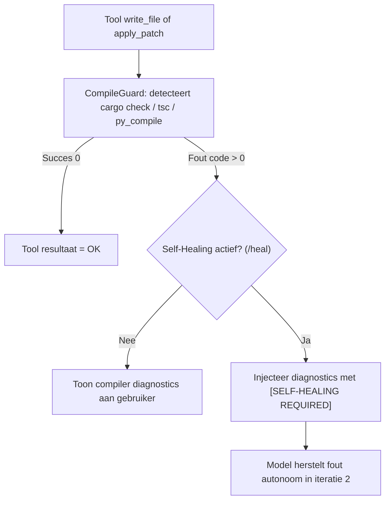

# Orbit CLI (`orbit-cli`) - Diepgaande Handleiding & Referentie
*Versie: 0.2.0 - Oktober 2026*

De **Orbit CLI** (`orbit-cli`) is een autonome, high-performance programmeerassistent geschreven in pure Rust. Gebouwd bovenop de multi-model API van OpenRouter levert Orbit real-time streaming, volledige Model Context Protocol (MCP `2024-11-05`) tool-calling in zowel REPL als TUI, automatische subagent-orkestratie, git-intelligentie en compilerspecifieke kwaliteitsbewaking.

Deze handleiding documenteert alle subsystemen, configuratiebestanden, startmodi, MCP-servers en commando's met diepgaande technische achtergrond en concrete gebruiksscenario's.

---

## 1. Architectuur & Kernprincipes

Orbit is ontworpen rond vier architecturale pijlers:

1. **Minimale latency en zero runtime overhead**:
   - Gecompileerd naar een single native Rust-binary (`orbit-cli` met `orbit` symlink).
   - Start in minder dan 10 milliseconden op zonder `node_modules`, zware runtime-containers of elektron-webviews.
2. **Deterministic Code Quality & Compile Guards**:
   - Geen "blind" genereren van code. Na elke bestandswijziging draait Orbit automatisch een AST-compiler- of type-check (`cargo check`, `tsc --noEmit`, `py_compile`, `go vet`).
   - Bij compilerfouten start automatisch een self-healing lus die de fouten herstelt vóórdat de gebruiker ermee geconfronteerd wordt.
3. **Kostenefficiëntie via Routing & Prompt Caching**:
   - Automatische injectie van ephemere `cache_control` headers voor systeemprompts en repository-regels, wat leidt tot 80–90% lagere tokenkosten op Claude en DeepSeek.
   - Tweeledige routering: snelle, goedkope modellen (Gemini 2.5 Flash) voor repository-verkenning en zware reasoning-modellen (Claude Sonnet 4.5, DeepSeek R1) voor implementatie.
4. **Surgical In-Place Patching**:
   - Ondersteuning voor Aider-stijl `<<<<<<< SEARCH ... ======= ... >>>>>>> REPLACE` blokken. In plaats van hele bestanden van 1.000 regels opnieuw te genereren (wat hallucinaties en tokenverspilling veroorzaakt), past Orbit uitsluitend de gewijzigde regels in-place aan.

---

## 2. Installatie & Systeemconfiguratie

### 2.1 Installatiemethoden

#### Optie 1: One-Line Installer (Linux & macOS)
```bash
curl -fsSL https://raw.githubusercontent.com/dwaddle/orbit-cli/main/install.sh | sh
```
Installeert `orbit-cli` en de `orbit` symlink in `~/.local/bin`.

#### Optie 2: Cargo (Rust)
```bash
cargo install --git https://github.com/dwaddle/orbit-cli
```

#### Optie 3: Arch Linux (`PKGBUILD`)
```bash
git clone https://github.com/dwaddle/orbit-cli.git
cd orbit-cli/packaging/aur && makepkg -si
```

#### Optie 4: Lokale Binaire Plaatsing
Op dit systeem bevindt de gecompileerde release-binary zich tevens in:
```bash
/home/rene/bin/orbit-cli
```
Deze map bevindt zich in de `$PATH` en wordt beheerd via `chezmoi`.

### 2.2 Centrale Configuratie (`~/.config/openrouter/config.json`)
Bij de eerste opstart maakt Orbit automatisch de map `~/.config/openrouter/` aan en vraagt interactief om je OpenRouter API-sleutel als deze ontbreekt.

Voorbeeld van een geavanceerde `config.json`:
```json
{
  "api_key": "sk-or-v1-...",
  "active_model": "anthropic/claude-sonnet-4.5",
  "tools_enabled": true,
  "prompt_caching": true,
  "cascading_enabled": false,
  "fast_model": "google/gemini-2.5-flash",
  "heavy_model": "anthropic/claude-sonnet-4.5",
  "fallback_models": [
    "anthropic/claude-sonnet-4.5",
    "openai/gpt-4o",
    "deepseek/deepseek-r1",
    "google/gemini-2.5-flash"
  ],
  "adversarial_review_enabled": false,
  "compile_guard_enabled": true,
  "self_healing_enabled": true,
  "syntax_highlighting": true,
  "vim_mode": true
}
```

#### Instellingen uitgelegd:
| Sleutel | Type | Standaard | Beschrijving |
|---|---|---|---|
| `api_key` | String | `""` | OpenRouter API bearer token (`sk-or-v1-...`). |
| `active_model` | String | `anthropic/claude-sonnet-4.5` | Het standaardmodel voor prompts in de REPL en TUI. |
| `tools_enabled` | Boolean | `true` | Schakelt automatische tool-aanroepen in/uit (in zowel REPL als TUI). |
| `prompt_caching` | Boolean | `true` | Injecteert OpenRouter `cache_control` headers voor statische context. |
| `cascading_enabled` | Boolean | `false` | Activeert tweetraps model-escalatie op basis van prompt-complexiteit. |
| `fast_model` | String | `google/gemini-2.5-flash` | Model gebruikt voor verkenning, samenvatting en zoekopdrachten. |
| `heavy_model` | String | `anthropic/claude-sonnet-4.5` | Model gebruikt voor complexe refactors en code-generatie. |
| `fallback_models` | Array | `[...]` | Prioriteitsketen voor auto-failover bij 429 (rate-limit) of 5xx serverfouten. |
| `compile_guard_enabled` | Boolean | `true` | Voert automatisch compiler-checks uit direct na `write_file` en `apply_patch`. |
| `self_healing_enabled` | Boolean | `true` | Voedt compilatiefouten autonoom terug aan het model voor self-repair. |
| `adversarial_review_enabled` | Boolean | `false` | Start automatisch een onafhankelijke reviewer subagent na elke bestandswijziging. |
| `syntax_highlighting` | Boolean | `true` | Activeert real-time syntaxkleuring voor markdown code-blokken tijdens streaming. |
| `vim_mode` | Boolean | `true` | Activeert Vim modal editing (Normal/Insert/Visual) in zowel de CLI REPL als de TUI. |

### 2.3 Model Context Protocol (MCP `2024-11-05`) Configuratie & Dagelijkse Servers
Orbit ondersteunt het volledige **Model Context Protocol (`2024-11-05`)** over `stdio` (JSON-RPC 2.0), inclusief de verplichte `notifications/initialized` handshake zodat zowel Rust/Node als Python `FastMCP` servers onmiddellijk al hun tools en JSON-schema's registreren.

De configuratie wordt ingelezen uit `~/.config/openrouter/mcp.json` of `~/.config/orbit/mcp.json`:

```json
{
  "mcpServers": {
    "system-watchdog": {
      "command": "/home/rene/bin/watchdog-mcp-server",
      "args": []
    },
    "bounty-trader-intelligence": {
      "command": "/home/rene/bin/bounty-trader-mcp-server",
      "args": []
    },
    "code-quality-auditor": {
      "command": "/home/rene/bin/code-quality-mcp-server",
      "args": []
    },
    "org-life-mcp": {
      "command": "/home/rene/bin/org-life-mcp-server",
      "args": []
    },
    "options-desk-mcp": {
      "command": "/home/rene/bin/options-desk-mcp-server",
      "args": []
    },
    "bugbounty-recon-mcp": {
      "command": "/home/rene/bin/bugbounty-recon-mcp-server",
      "args": []
    },
    "personal-finance-mcp": {
      "command": "/home/rene/bin/personal-finance-mcp-server",
      "args": []
    }
  }
}
```

#### Overzicht van de 7 geconfigureerde MCP-servers:
| MCP Server | Tools & Toepassing |
|---|---|
| `org-life-mcp` | `get_daily_org_agenda`, `capture_org_todo`, `search_org_knowledge`, `import_youtube_recipe` (Emacs Org-mode agenda, taken, kennisbank & YouTube recepten). |
| `options-desk-mcp` | `get_live_portfolio_snapshot`, `check_vix_regime_and_triggers`, `deploy_combo_update` (GCP VM DB sync, live optie-posities, VIX-regime). |
| `bugbounty-recon-mcp` | `passive_recon_summary`, `ask_openrouter_specialist` (Subfinder/httpx/nuclei recon en second-opinion analyse). |
| `system-watchdog` | `check_chezmoi_status`, `chezmoi_stage_and_commit`, `audit_pacnew_files`, `check_systemd_and_timers`, `sync_gcp_trading_db`, `check_system_health`. |
| `personal-finance-mcp` | `import_statement_csv` (Bank CSV-afschriften importeren en categoriseren naar `~/Org/transactie_overzicht.org`). |
| `bounty-trader-intelligence` | `get_verified_bounties`, `check_repo_rotation_eligibility`, `get_live_options_portfolio`, `deploy_combo_trading_to_vm`, `passive_recon_domain`. |
| `code-quality-auditor` | `run_prepush_quality_check`, `run_zero_flake_check`, `run_empirical_benchmark`, `run_ast_and_fuzz_audit`, `audit_against_maintainer_rules`, `generate_pr_template`. |

#### Hoe MCP werkt in REPL én TUI (`orbit -t`):
- Bij het opstarten spawnt Orbit elke MCP-server op de achtergrond, voert `initialize` + `notifications/initialized` + `tools/list` uit en injecteert zowel de tool-namen als de verwachte JSON-parameters in de systeemprompt.
- Met `/mcp` (in zowel de REPL als de fullscreen TUI) bekijk je direct alle actieve MCP-servers en hun geladen tools.
- Wanneer je een vraag stelt in natuurlijke taal (bijv. *"Laat mijn Org-agenda voor vandaag zien"* of *"Controleer of er .pacnew bestanden zijn"*), roept het model autonoom `<tool_call>{"name": "...", "arguments": {...}}</tool_call>` aan, voert Orbit de JSON-RPC `tools/call` uit en streamt het eindantwoord direct terug in de REPL of het TUI-chatvenster.

### 2.4 Automatische Projectregels (`.orbitrules` / `AGENTS.md`)
Bij elke interactie zoekt Orbit vanaf de huidige directory recursief omhoog naar projectregelbestanden in de volgende volgorde:
1. `.orbitrules`
2. `AGENTS.md`
3. `.agents/AGENTS.md`
4. `.orbit/rules.md`

De inhoud wordt automatisch als strikte systeeminstructies bovenin de LLM-context geplaatst.

---

## 3. Startmodi & Commandline-Vlaggen

### A. Interactieve REPL (Standaard)
```bash
orbit-cli
# of:
orbit
```
Start de interactieve terminal interface. Ondersteunt inline geschiedenis (pijltje omhoog/omlaag), Vim modal editing (`orbit [INSERT] >`), multi-line prompts (`\`) en slash commands (`/...`).

### B. Fullscreen Split TUI (Ratatui)
```bash
orbit-cli --tui
# of:
orbit -t
```
Start een grafische split-pane terminal interface op basis van `ratatui` en `crossterm`, geoptimaliseerd met een **high-contrast kleurenpalet** (`White`, `Cyan`, `LightGreen`, `Yellow`) zodat alle tekst haarscherp leesbaar is op transparante terminals:
- **Linkerpaneel**: Interactieve workspace bestandsbrowser (`Cyan` voor mappen, helder `White` voor bestanden).
- **Rechterbovenpaneel**: Real-time monitor voor actieve subagent-taken en status.
- **Rechteronderpaneel**: Streaming chatvenster met syntaxkleuring, autonome tool- en MCP-executie (tot 6 iteraties per turn) en actieve geschiedenis.
- **Onderbalk**: Interactieve invoerbalk met Vim-modus indicator.
- **Navigatie**: Wissel focus tussen panelen met `[Tab]`, navigeer met `j`/`k` of `[Up]`/`[Down]`, sluit af met `q` (in Normal mode) of `[Ctrl-c]`.

### C. File Watcher & Test Loop Modus
```bash
orbit-cli watch
# of binnen de REPL:
/watch start
```
Start een achtergrondproces gebaseerd op de Rust `notify` crate:
- Bewaakt recursief alle bronbestanden (`.rs`, `.py`, `.ts`, `.js`, `.go`) in de werkmap.
- Hanteert een debounce-timer van 400ms om tussenliggende bestandswijzigingen te bundelen.
- Detecteert automatisch het testsysteem van het project (`cargo test`, `pytest`, `bun test`, `npm test`, `go test`).
- Voert direct tests uit bij opslaan en toont compacte pass/fail banners in de terminal.

---

## 4. Multi-Model Routing, Caching & Veerkracht

### 4.1 Prompt Caching (`/cache`)
Moderne LLM's (zoals Claude Sonnet 4.5 en DeepSeek V3/R1) ondersteunen ephemere prompt caching. Omdat Orbit statische systeemprompts, projectregels en referentiebestanden vooraf markeert met:
```json
"cache_control": { "type": "ephemeral" }
```
berekent OpenRouter voor gecachte tokens slechts 10% van de normale invoerkosten.
- Toggle met `/cache`.
- Bekijk de status via `/routing`.

### 4.2 Hybrid Model Cascading (`/cascade`)
Niet elke vraag vereist een topmodel van $15 per miljoen tokens. Met cascading actief classificeert Orbit inkomende prompts op runtime:
- **Snelle / Verkennende queries** (bijv. "Waar staat de declaratie van struct X?", bestandsinspecties, syntaxtests): Worden afgehandeld door het `fast_model` (`google/gemini-2.5-flash`).
- **Complexe implementatie & Synthese** (bijv. "Herschrijf de query engine met transaction rollbacks", wiskundige berekeningen, multi-file refactors): Worden automatisch geëscaleerd naar het `heavy_model` (`anthropic/claude-sonnet-4.5`).
- Toggle met `/cascade`.

### 4.3 Provider Outage & Rate-Limit Auto-Failover (`/fallback`)
Bij zware belasting op OpenRouter kan een model tijdelijk HTTP 429 (Rate Limit), 502/503 (Bad Gateway) of 504 (Timeout) retourneren.
Orbit onderbreekt je sessie niet, maar schakelt onmiddellijk over naar de volgende kandidaat in de `fallback_models` keten:
1. `anthropic/claude-sonnet-4.5`
2. `openai/gpt-4o`
3. `deepseek/deepseek-r1`
4. `google/gemini-2.5-flash`

Pas de volgorde aan via:
```text
/fallback anthropic/claude-sonnet-4.5,openai/gpt-4o,deepseek/deepseek-r1
```

---

## 5. Code Editing & Kwaliteitsborging

### 5.1 Surgical Search-and-Replace Patching (`apply_patch`)
In plaats van hele bestanden te overschrijven met `write_file`, instrueert Orbit het model om gerichte patch-blokken te produceren:

```text
<<<<<<< SEARCH
    let timeout = 30;
    connect_to_server(timeout)?;
=======
    let timeout = 60;
    connect_to_server(timeout * 2)?;
>>>>>>> REPLACE
```

#### Voordelen van de patch-engine (`src/patch.rs`):
- **Tokenbesparing**: In een bestand van 1.500 regels hoeft slechts een blok van 10 regels gegenereerd te worden (95% minder output-tokens).
- **Anti-Hallucinatie**: Ongewijzigde methodes kunnen niet per ongeluk verdwijnen of veranderen.
- **Disambiguation Guard**: Als het `SEARCH`-blok meerdere keren voorkomt in het bestand, weigert Orbit de patch met een duidelijke foutmelding zodat het model een uniekere context moet specificeren.

### 5.2 AST Compile Guard & Self-Healing Loop (`/guard`, `/heal`, `/compile`)
Direct nadat een bestand is aangepast via `write_file` of `apply_patch`, activeert Orbit de `CompileGuard` (`src/compile_guard.rs`):



- Handmatige verificatie uitvoeren: `/compile` of `/check`.
- Compile Guard in/uitschakelen: `/guard`.
- Self-Healing in/uitschakelen: `/heal`.

### 5.3 Instant Checkpoints & Time-Machine Rollback (`/undo`, `/checkpoints`)
Vóór elke muterende operatie legt de `CheckpointManager` (`src/checkpoint.rs`) een in-memory snapshot vast van het doelbestand.

- **`/undo`**: Draait onmiddellijk de laatste bestandswijziging terug naar de exacte toestand van voor de tool-call. Als een bestand nieuw werd aangemaakt, verwijdert `/undo` het bestand netjes van schijf.
- **`/checkpoints`**: Toont de stapel met recente snapshots en tijdstempels.

### 5.4 Deterministic TDD Loop (`/tdd <spec>`)
Orbit kan autonoom software ontwikkelen volgens het strikte Red-Green-Refactor paradigma (`src/tdd.rs`):

```bash
/tdd Implementeer een LRU-cache met capaciteit 100 en O(1) get/put operaties
```

1. **Red Phase**: Orbit genereert eerst falende unit tests die de specificatie valideren en draait lokaal de test runner (`cargo test`) om te bewijzen dat ze falen.
2. **Green Phase**: Orbit schrijft de minimale implementatiecode om de tests te laten slagen. Als de tests falen, draait een bounded herstellus (maximaal 3 pogingen) tot alle tests 100% slagen.
3. **Refactor Phase**: Schoonmaken van code en optimaliseren van documentatie met behoud van de groene teststatus.

---

## 6. Subagents, DAG Orchestratie & Adversarial Review

### 6.1 Directed Acyclic Graph (DAG) Orchestratie (`/dag`)
Voor complexe taken kunnen meerdere subagents gelijktijdig taken uitvoeren via Tokio channels (`src/subagent.rs`). Upstream resultaten worden automatisch geïnjecteerd in downstream prompts:

```text
/dag audit
```
Start een audit workflow:
1. `Task 1 (Security)`: Scant de code op injecties en kwetsbaarheden.
2. `Task 2 (Performance)`: Analyseert runtime bottlenecks en geheugenallocaties.
3. `Task 3 (Synthesis)`: Voegt de bevindingen van Task 1 en 2 samen in een eindrapport.

Andere workflow:
```text
/dag feature
```
Voert parallelle planning, testontwerp en documentatiegeneratie uit.

### 6.2 Dual-Agent Adversarial Review (`/review`, `/adversarial`)
Geen code mag blind vertrouwd worden. Het review-subsysteem (`src/review.rs`) start een onafhankelijke reviewer subagent die code-diffs beoordeelt over 5 strikte assen:
1. **Correctheid**: Logische bugs, edge-cases, off-by-one errors.
2. **Beveiliging**: OWASP kwetsbaarheden, geheugenveiligheid, ongevalideerde invoer.
3. **Fouthandeling**: Ontbrekende error context, panics, unwrap-misbruik.
4. **Testdekking**: Ontbrekende regressietests, ongeteste paden.
5. **Prestaties**: O(N²) complexiteit, onnodige klonen of allocaties.

- Direct een bestand of diff reviewen: `/review [pad]`
- Automatische review inschakelen na elke bestandswijziging: `/adversarial`

---

## 7. Workspace Intelligentie & Lokale Tools

Orbit beschikt over 11 autonome built-in workspace tools (naast alle dynamisch geladen MCP-tools):

| Tool | Functie |
|---|---|
| `run_command` | Lokale shell commando's uitvoeren en output vastleggen. |
| `view_file` | Bestanden inspecteren met optionele regelbereiken. |
| `write_file` | Bestanden volledig nieuw aanmaken of overschrijven. |
| `apply_patch` | Aider-stijl chirurgische zoek-en-vervang blokken toepassen. |
| `tdd_cycle` | Autonome Red -> Green -> Refactor TDD cyclus doorlopen. |
| `code_search` | BM25 zoekindex doorzoeken op trefwoorden en symbolen. |
| `code_outline` | Functies, structs, classes en traits in kaart brengen. |
| `git_context` | Commit log, line-range blame, unified diffs en pickaxe doorzoeken. |
| `invoke_subagent`| Achtergrond subagent spawnen voor deeltaken. |
| `adversarial_review` | 5-assen security- en regressie-audit uitvoeren. |
| `run_dag` | Multi-agent DAG werkstromen parallel uitvoeren. |

### 7.1 Inverted BM25 Code Search (`/search <term>`)
Orbit bouwt een in-memory omgekeerde index (`src/search_index.rs`) op over alle broncodebestanden in de workspace:
- Splitst `camelCase` en `snake_case` identifiers automatisch.
- Berekent BM25 relevantiescores.
- Toont direct contextregels rondom de treffers.

### 7.2 Codebase Symbol Outline (`/outline [pad]`)
Genereert een compacte symbolen-index (`src/outline.rs`) over functies, structs, traits, en modules voor:
- Rust (`fn`, `struct`, `enum`, `impl`, `trait`, `mod`)
- Python (`def`, `class`, decorators)
- TypeScript / JavaScript (`function`, `class`, `interface`, `type`)
- Go (`func`, `struct`, `interface`, `package`)

### 7.3 Git History Intelligence (`/git`)
- Commit logs bekijken: `/git log 5`
- Blame op specifieke regels: `/git blame src/main.rs 10-25`
- Recente diff bekijken: `/git diff`
- Zoeken wanneer een symbool werd geïntroduceerd (pickaxe): `/git search <symbool>`

---

## 8. Real-Time Streaming Syntax Highlighting (`/highlight`, `/syntax`)

Tijdens het streamen van LLM-antwoorden vangt de `StreamingHighlighter` (`src/highlight.rs`) binnenkomende SSE token-chunks op:
- **Line-buffering**: Voorkomt haperende ANSI-escape codes bij gedeeltelijke tokens.
- **Language Lexer**: Herkent en kleurt keywords, types, strings, getallen, macro's en commentaar voor:
  `Rust`, `Python`, `TypeScript/JavaScript`, `Go`, `Bash`, `SQL`, `JSON`, `TOML`, `YAML`, `C/C++`.
- **Visuele Code Kaders**: Omkadert code-blokken met nette terminalranden:
  ```text
  ╭─── [rust] ──────────────────────────────────────────────────────────
  │ pub fn main() {
  │     println!("Hello, Orbit!");
  │ }
  ╰─────────────────────────────────────────────────────────────────────
  ```
- **Markdown Elementen**: Headers, inline backticks (`` `code` ``), vette tekst en lijsten worden buiten code-blokken direct leesbaar geaccentueerd.
- Toggle met `/highlight` of `/syntax`.

---

## 9. Volledige Slash Commands Referentietabel

| Commando | Parameters | Beschrijving |
|---|---|---|
| `/help` | Geen | Toont het beknopte commando-overzicht (beschikbaar in REPL en TUI). |
| `/model` | `[search\|id\|nr]` | Toont het huidige model of zoekt en wisselt van actief model. |
| `/undo` | Geen | Herstelt de laatste bestandswijziging direct naar het vorige checkpoint. |
| `/checkpoints`| Geen | Geeft een overzicht van de snapshot-historie en gewijzigde bestanden. |
| `/compile` | Geen | Draait onmiddellijk een compiler- of typecheck op de werkdirectory. |
| `/guard` | Geen | Schakelt de automatische AST Compile Guard (post-write checks) AAN of UIT. |
| `/heal` | Geen | Schakelt de compiler self-healing herstellus AAN of UIT. |
| `/tdd` | `<spec>` | Start een autonome Test-Driven Development cyclus. |
| `/dag` | `[audit\|feature]` | Start een parallelle multi-agent Directed Acyclic Graph werkstroom. |
| `/review` | `[bestand\|diff]` | Start een 5-assen adversarial security en kwaliteitsreview. |
| `/adversarial`| Geen | Schakelt automatische adversarial review bij bestandswijzigingen AAN of UIT. |
| `/watch` | `[start\|stop\|run]`| Beheert de achtergrond file watcher en automatische testloop. |
| `/highlight` | Geen | Schakelt streaming syntaxkleuring en visual code framing AAN of UIT. |
| `/syntax` | Geen | Alias voor `/highlight`. |
| `/vim` | Geen | Schakelt Vim modal edit mode (Normal/Insert/Visual live prompt & TUI) AAN of UIT. |
| `/cache` | Geen | Schakelt OpenRouter prompt caching headers AAN of UIT. |
| `/cascade` | Geen | Schakelt hybrid model cascading (Flash vs Sonnet) AAN of UIT. |
| `/routing` | Geen | Toont actieve routeringsniveaus, cachestatistieken en failover-status. |
| `/fallback` | `<m1,m2,...>` | Configureert de prioriteitsvolgorde voor failover-modellen. |
| `/tools` | Geen | Schakelt autonome tool-executie AAN of UIT (beschikbaar in REPL en TUI). |
| `/tui` | Geen | Schakelt over naar de fullscreen split-pane Ratatui interface. |
| `/subagents` | Geen | Inspecteert actieve en voltooide achtergrondtaken van subagents. |
| `/mcp` | Geen | Geeft een lijst van alle actieve MCP-servers en geregistreerde tools (in REPL en TUI). |
| `/search` | `<zoekterm>` | Zoekt door de repository via de in-memory BM25 index. |
| `/outline` | `[pad]` | Genereert een symbolenoverzicht van functies, classes en types. |
| `/git` | `<subcmd> [arg]` | Inspecteert git context (`log`, `blame`, `diff`, `search`). |
| `/rules` | Geen | Toont de actieve `.orbitrules` of `AGENTS.md` projectregels. |
| `/context` | Geen | Geeft inzicht in tokenverbruik en contextbudget van de sessie. |
| `/prune` | Geen | Comprimeert handmatig grote tool-outputs en vat eerdere gesprekken samen. |
| `/file` | `<pad>` | Leest een lokaal bestand in en injecteert dit direct in de context. |
| `/clear` | Geen | Wist de gespreksgeschiedenis van de huidige sessie. |
| `/key` | `<sleutel>` | Werkt de opgeslagen OpenRouter API-sleutel bij. |
| `/exit` | Geen | Sluit Orbit CLI af. |

---

## 10. Vim Modal Editing & Keybindings (TUI & REPL)

Orbit CLI ondersteunt naadloze **Vim modal editing** in zowel de interactieve REPL als de fullscreen Ratatui TUI.

### 10.1 REPL Vi Mode (`/vim`)
In de interactieve terminal prompt schakelt `/vim` tussen standaard Emacs editing en een volwaardige live modal editing engine (`src/modal_prompt.rs`).

#### Live Prompt Modus Indicators & Cursor
Tijdens het typen in de CLI prompt zie je **realtime per toetsaanslag** in welke modus je zit:
- **Insert Mode**: `orbit [INSERT] > ` (groene badge, verticale bar cursor `|`)
  - Type prompt tekst zoals gebruikelijk.
  - `Backspace` / `Delete`: Verwijder tekens.
  - `Ctrl-w`: Verwijder vorig woord.
  - `Ctrl-u`: Wis invoerregel tot begin.
  - `Esc`: Schakelt direct over naar `[NORMAL]` modus.
  - `Enter`: Verzendt de prompt.
- **Normal Mode**: `orbit [NORMAL] > ` (gele badge, blok cursor `█`)
  - `i` / `I`: Keer terug naar Insert modus (op cursor of aan begin van regel).
  - `a` / `A`: Keer terug naar Insert modus na de cursor of aan het einde van de regel.
  - `v` / `V`: Activeer direct **Visual Mode** (`[VISUAL]`) voor karakterselectie!
  - `h` / `l`: Karakter links / rechts.
  - `w` / `b`: Woord vooruit / achteruit springen.
  - `0` / `$`: Begin / einde van de regel.
  - `x` / `X`: Karakter verwijderen en in yank-buffer plaatsen.
  - `dw` / `d$` / `d0` / `dd`: Woord, deel of hele regel wissen naar yank-buffer.
  - `cw` / `cc` / `C` / `s` / `S`: Tekst wijzigen en direct naar Insert mode gaan.
  - `r<char>`: Vervang één karakter onder de cursor.
  - `yy`: Kopieer hele regel naar yank-buffer.
  - `p` / `P`: Plak de inhoud van de yank-buffer na of voor de cursor.
  - `u`: Undo (herstelt vorige toestand).
  - `k` / `j` (of `Up`/`Down`): Navigeer door de command history.
  - `Enter`: Verzendt de prompt.
- **Visual Mode**: `orbit [VISUAL] > ` (magenta badge, omgekeerde video selectie `\x1b[7m`)
  - `h` / `l` / `w` / `b` / `0` / `$`: Breid de visuele selectie uit.
  - `y`: Yank de geselecteerde tekst naar de buffer en keer terug naar `[NORMAL]`.
  - `d` / `x`: Knip de geselecteerde tekst naar de buffer en keer terug naar `[NORMAL]`.
  - `c`: Knip de geselecteerde tekst en ga direct naar `[INSERT]`.
  - `Esc` / `v`: Annuleer selectie en keer terug naar `[NORMAL]`.

### 10.2 Fullscreen TUI Vim Navigatie & Modus Indicators (`/tui` of `--tui`)

De TUI biedt drie expliciete realtime indicators die aangeven in welke modus je zit (`NORMAL`, `INSERT`, of `VISUAL`):
1. **Footer Statusbalk (linksonder)**: High-contrast badge met de actieve modus en dynamische context-hints:
   - ` NORMAL ` (geel blok, zwarte tekst)
   - ` INSERT ` (groen blok, zwarte tekst)
   - ` VISUAL ` (magenta blok, zwarte tekst)
2. **Prompt Invoerveld Header**: Titelbadge `[NORMAL]`, `[INSERT]`, of `[VISUAL]`. De vensterrand (border) kleurt tevens mee (geel in Normal, groen in Insert, magenta in Visual).
3. **Cursor Glyph**:
   - `█` (volledig blok) in Insert modus.
   - `▒` (shaded blok) in Normal modus.
   - `▚` (checker glyph) in Visual modus.

| Toets | Modus | Actie |
|---|---|---|
| `i` / `a` / `o` / `/` | Normal | Activeert `[INSERT]` mode en focust direct het prompt invoerveld. |
| `Esc` / `Ctrl-[` | Insert / Visual | Keert terug naar `[NORMAL]` modus (annuleert tevens actieve visual selectie). |
| `v` / `V` | Normal | Activeert `[VISUAL]` modus in het actieve venster (Chat geschiedenis of Bestanden). |
| `j` / `Down` | Normal / Visual | Beweegt omlaag in bestandslijst of breidt visual selectie / scroll omlaag uit. |
| `k` / `Up` | Normal / Visual | Beweegt omhoog in bestandslijst of breidt visual selectie / scroll omhoog uit. |
| `y` / `Y` | Visual | **Yank**: kopieert de geselecteerde regels of bestandspaden naar de interne buffer en keert terug naar Normal mode. |
| `p` / `P` | Normal | **Paste**: plakt de inhoud van de yank-buffer direct in het prompt invoerveld. |
| `h` / `Left` | Normal | Schakelt horizontaal van Workspace (Chat/Input) naar Sidebar (Files/Subagents). |
| `l` / `Right` | Normal | Schakelt horizontaal van Sidebar naar Workspace. |
| `w` / `Tab` | Normal/Insert/Visual | Wisselt voorwaarts tussen de actieve panelen. |
| `b` / `Shift-Tab` | Normal/Insert/Visual | Wisselt achterwaarts tussen panelen. |
| `gg` | Normal / Visual | Springt direct naar het begin (top) van de chat of bestandenlijst. |
| `G` | Normal / Visual | Springt direct naar het einde (bottom) en reactiveert auto-scroll. |
| `Ctrl-d` / `PageDown`| Normal/Insert | Scrollt een halve pagina omlaag in de chat. |
| `Ctrl-u` / `PageUp`  | Normal/Insert | Scrollt een halve pagina omhoog in de chat. |
| `Ctrl-f` / `Ctrl-b`  | Normal | Scrollt een volledige pagina omlaag / omhoog. |
| `Enter` op Files | Normal | Injecteert het geselecteerde bestand direct in de prompt (`/file <naam>`). |
| `Enter` op Input | Insert | Verzendt de prompt naar het actieve model (of voegt regel toe bij afsluitende `\`). |
| `Ctrl-j` | Insert | Voegt direct een nieuwe regel toe in het invoerveld (multi-line). |
| `q` | Normal | Sluit de TUI af en keert terug naar de terminal. |
| `Ctrl-c` | Globaal | Onderbreekt live model-generatie of verlaat de TUI. |

### 10.3 Multi-Line Prompts met Backslash (`\`)

Zowel in de interactieve CLI REPL als in de fullscreen TUI kun je eenvoudig gestructureerde prompts over meerdere regels verdelen met behulp van een backslash (`\`) aan het einde van de regel:

#### 1. In de CLI REPL
- Typ je eerste regel en sluit af met `\`.
- Druk op `Enter`. De trailing `\` wordt automatisch gestript en de prompt toont een vervolg-indicator met behoud van de actieve Vim-modus:
  ```text
  orbit [INSERT] > Analyseer de volgende onderdelen:\
  ...   [INSERT] > - Database migraties in src/db.rs\
  ...   [INSERT] > - Foutafhandeling in src/api.rs\
  ...   [INSERT] > Geef een concreet refactorvoorstel.
  ```
- Ook in `[NORMAL]` en `[VISUAL]` modus blijft de navigatie over de huidige regel werken (`... [NORMAL] > `).
- Pas wanneer je op `Enter` drukt op een regel **zonder** afsluitende `\`, wordt de volledige samengestelde prompt naar het model verzonden.
- Druk op `Ctrl-C` tijdens multi-line invoer om de buffer te annuleren en direct terug te keren naar de normale prompt (`orbit [INSERT] > `).

#### 2. In de Fullscreen TUI (`/tui`)
- Typ een regel eindigend op `\` en druk op `Enter` (of gebruik `Ctrl-J`): de regel wordt gecontinueerd en voorafgegaan door een `... ` prefix.
- Het invoervak breidt zich dynamisch uit (tot 8 regels) zodat je volledige prompt overzichtelijk zichtbaar blijft zonder direct het chatvenster te overschaduwen.
- Druk op `Enter` op een regel zonder afsluitende `\` om de prompt in te dienen.

---

## 11. Praktische Gebruiksscenario's & Workflows

### Scenario 1: Nieuwe Module Bouwen via TDD
In plaats van code te laten schrijven en daarna pas na te denken over tests:
```text
orbit > /tdd Bouw een TokenBucket rate limiter in Rust met burst-ondersteuning en thread-safety via Arc<Mutex>
```
Orbit schrijft eerst de testgevallen in `tests/`, valideert dat `cargo test` faalt (Red), schrijft daarna de struct in `src/`, valideert tot `cargo test` slaagt (Green) en refactort de code.

### Scenario 2: Complexe Refactor met Veiligheidsnet
Als je een kritieke functie wilt aanpassen zonder risico op breuk:
1. Controleer of de Compile Guard aan staat: `/guard` (moet `ENABLED` zijn).
2. Laat de assistent de patch uitvoeren via `apply_patch`.
3. Mocht de compiler breken, dan repareert Orbit de fout direct autonoom via `/heal`.
4. Ben je niet tevreden met het resultaat? Eén commando herstelt alles direct:
   ```text
   orbit > /undo
   ```

### Scenario 3: Grondige Security- & Kwaliteitsaudit
Voorbereiden van een pull request:
```text
orbit > /dag audit
```
Subagent 1 controleert op security flaws, Subagent 2 meet performance-bottlenecks en Subagent 3 produceert een samenvattend auditrapport in de terminal.

### Scenario 4: Dagelijkse Workflow & Systeembeheer via MCP
Omdat MCP-servers in zowel de REPL als de TUI (`orbit -t`) actief zijn, kun je direct vanuit Orbit je systeem, optie-portfolio, bugbounty-pipeline en Emacs Org-agenda aansturen:
```text
orbit > Laat mijn Org-agenda voor vandaag zien en controleer of er nog .pacnew bestanden zijn.
```
Orbit roept automatisch `get_daily_org_agenda` (`org-life-mcp`) en `audit_pacnew_files` (`system-watchdog`) aan en presenteert direct het gecombineerde resultaat.
